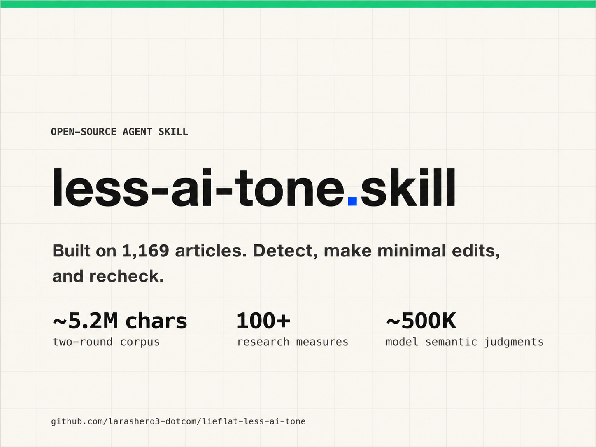

# Lieflat Less AI Tone

[中文](README.md) | English



**A post-draft Chinese writing skill built from two rounds of comparison: 629 articles in the first round, 270 matched pairs in the second, about 5.2 million Chinese characters in total, and about 500,000 model semantic judgments.** It reports what it found, cites passages from your draft, and proposes specific edits. It rewrites only after you respond, then runs a second check and shows the changes.

## What the study measured

The first round compared 300 model-written articles with 329 human-written articles across aligned topics. Its 2,826,972 characters provided an initial screen for commonly claimed signs of “AI tone.” The second round controlled a major confound: each of 270 generated articles was paired with a human article on the same topic, using the same factual material and an aligned length. GPT-5.6 produced 135 of the generated articles and Claude Opus 4.6 produced the other 135; the two models were analyzed separately.

Three methods handled different kinds of evidence:

| Method | What it measured | Scope |
|---|---|---|
| Scripts | Punctuation, sentence and section structure, lexical measures, and other countable features | 90 measures across all 540 second-round articles |
| Model semantic assessment | Whether a candidate passage meets a narrowly defined semantic criterion | About 500,000 judgments during the study (431,000 in round two plus about 110,000 in a supplementary round), using Jev |
| Human review | Metaphor aptness and errors in machine judgments | Sentence-level annotation and sample checks |

The 500,000 judgments describe the **research**, not the number of model calls required to check one new draft. In ordinary use, the skill's scripts extract candidates and the current conversation model assesses them against the closed criteria in [references/semantic-criteria.md](./references/semantic-criteria.md).

## What changed after the matched-pair test

The second round overturned several plausible editing rules. “This means” style restatements and introductory lines before lists also failed as general deletion rules. A first-round suggestion to restore concrete detail was later withdrawn: a symmetric semantic check found passages becoming more vague in 24.7% of comparisons and more specific in 26.0%, a near-zero net difference. These items are reported as weak or rejected indicators and are **never edited merely because they appear**.

Model-specific habits also matter. The em-dash result points in opposite directions for GPT-5.6 and Opus 4.6: GPT used fewer than the human comparison, while Opus used more. A pooled “AI uses too many dashes” rule would hide both results. The skill reports such features as model fingerprints rather than treating them as universal defects.

Some measured signals are useful for diagnosis without licensing mechanical edits. Short, regular sections and uniform sentence rhythms can be reported, but the skill does not manufacture irregularity to hit a target value. Whether a metaphor works in context requires human review; the skill leaves metaphors alone by default.

The full Chinese analysis, including measure definitions, results, counterexamples, and limits, is in [README.md](./README.md) and [RESEARCH.md](./RESEARCH.md). [RESEARCH.en.md](./RESEARCH.en.md) provides an English summary of the second round and preserves the first-round record, clearly marked as historical.

## How the skill works

1. **Detect.** Run `scripts/detect.py` on a finished article, save the machine-readable result, extract semantic candidates, and assess those candidates against the closed criteria.
2. **Report before editing.** Present a readable report with the draft's counts or rates, the corresponding research evidence, located original passages, proposed edits, and reasons for leaving other passages untouched. A finding in the research corpus is not a significance test on the individual draft.
3. **Wait for a reply.** The user can accept the overall proposal with a short response or adjust its scope. The article is not rewritten before that reply.
4. **Rewrite and recheck.** Make the smallest accepted changes, preserve facts and qualifications, run detection again, and provide a before-and-after report. The default report is Markdown; an HTML side-by-side view is available when requested.

The [Agent memory article example](./examples/agent-memory-case/README.md) includes the initial report, revised article, side-by-side HTML comparison, and recheck conclusion. Operational rules and boundaries are in [SKILL.md](./SKILL.md); detection grades are explained in [DETECT.md](./DETECT.md).

## Install and try it

Ask an AI assistant that supports Agent Skills to install **Lieflat Less AI Tone** from this repository, or use:

```bash
npx skills add larashero3-dotcom/lieflat-less-ai-tone
```

Then give the assistant a finished Chinese article. It will report its findings and suggested changes first. Reply with the equivalent of “apply the suggestions” or specify a narrower scope to start rewriting.

The corpus is not redistributed because of copyright and privacy constraints. The scripts, definitions, and decision criteria are provided so the method can be rerun on a corpus you are allowed to use. The reported figures are observations from these samples, not a universal authorship detector.

**Files** [SKILL.md](./SKILL.md) · [DETECT.md](./DETECT.md) · [RESEARCH.md](./RESEARCH.md) · [scripts/](./scripts/) · [中文 README](./README.md)

**License** [CC BY-NC 4.0](./LICENSE)
