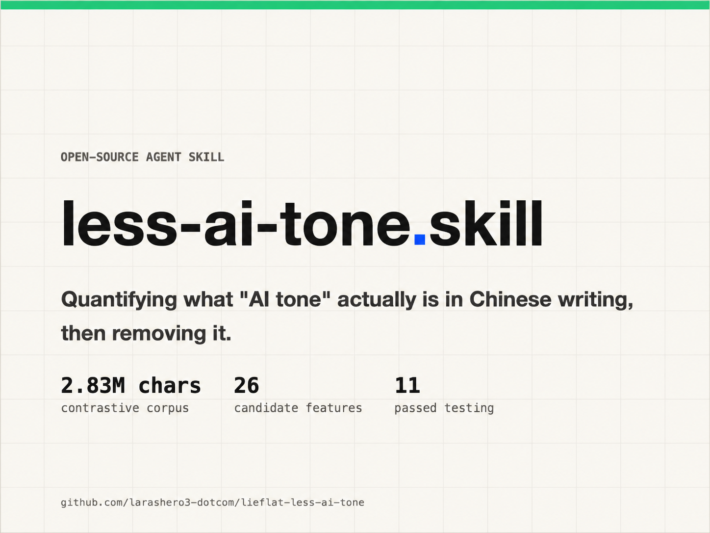

# Lieflat Less AI Tone

[中文](README.md) | [English](README.en.md) | 日本語



**2 回の比較研究から作った、中国語の原稿を書き上げた後に使う文章のスキルです。1 回目は 629 本の記事、2 回目は 270 組の対応ペアで、合計約 520 万字の中国語と、約 50 万回のモデルによる意味判定にもとづいています。** 見つけたことを報告し、原稿の該当箇所を引用して、具体的な修正を提案します。書き直すのはあなたが返事をした後だけで、その後に 2 回目のチェックを行い、変更点を示します。

## 研究で測ったこと

1 回目では、そろえたテーマについて、モデルが書いた 300 本の記事と人間が書いた 329 本の記事を比較しました。その 2,826,972 字は、「AI っぽさ」の兆候としてよく言われるものを最初にふるい分ける材料になりました。2 回目では、大きな交絡要因を統制しました。生成した 270 本の記事それぞれを、同じテーマで、同じ事実の素材を使い、長さをそろえた人間の記事と組にしたのです。生成した記事のうち 135 本は GPT-5.6、残りの 135 本は Claude Opus 4.6 が書き、2 つのモデルは別々に分析しました。

3 つの方法で、異なる種類の根拠を扱いました。

| 方法 | 測ったもの | 範囲 |
|---|---|---|
| スクリプト | 句読点、文と節の構造、語彙の指標、そのほか数えられる特徴 | 2 回目の 540 本すべての記事にわたる 90 の指標 |
| モデルによる意味の評価 | 候補の箇所が、狭く定義した意味の基準を満たすかどうか | 研究の間に約 50 万回の判定（2 回目の 431,000 回と、補足の回の約 110,000 回）、Jev を使用 |
| 人間のレビュー | 比喩の適切さと、機械の判定の誤り | 文単位の注釈とサンプルのチェック |

50 万回の判定は **研究** についての数字であり、新しい原稿を 1 本チェックするのに必要なモデルの呼び出し回数ではありません。普段の使い方では、スキルのスクリプトが候補を取り出し、今の会話のモデルが [references/semantic-criteria.md](./references/semantic-criteria.md) の閉じた基準に照らしてそれらを評価します。

## 対応ペアのテストの後に変わったこと

2 回目では、もっともらしく見えたいくつかの修正のルールが覆されました。「つまり」型の言い換えや、リストの前の導入の一文も、一般的な削除のルールとしては通用しませんでした。具体的な細部を取り戻すという 1 回目の提案は、後に撤回されました。対称的な意味のチェックでは、箇所がより曖昧になった比較が 24.7%、より具体的になった比較が 26.0% で、正味の差はほぼゼロだったのです。これらの項目は、弱い、または否定された指標として報告され、**現れたというだけで修正されることは決してありません**。

モデルごとの癖も重要です。ダッシュの結果は、GPT-5.6 と Opus 4.6 で逆の方向を示しました。GPT は人間の比較対象より少なく、Opus は多く使っていたのです。「AI はダッシュを使いすぎる」という、まとめたルールにすると、どちらの結果も見えなくなります。スキルは、こうした特徴を普遍的な欠点として扱うのではなく、モデルの指紋として報告します。

測った信号の中には、診断には役立っても、機械的な修正の根拠にはならないものがあります。短くて規則的な節や、一様な文のリズムは報告できますが、スキルは目標の値に合わせるために不規則さをこしらえることはしません。比喩が文脈の中でうまく機能しているかどうかは人間のレビューが必要なので、スキルはデフォルトでは比喩に手を付けません。

指標の定義、結果、反例、限界を含む中国語の完全な分析は、[README.md](./README.md) と [RESEARCH.md](./RESEARCH.md) にあります。[RESEARCH.en.md](./RESEARCH.en.md) には、2 回目の英語の要約があり、1 回目の記録も、過去のものとはっきり示したうえで残しています。

## スキルのしくみ

1. **検出する。** 完成した記事に `scripts/detect.py` を実行し、機械が読める結果を保存して、意味の候補を取り出し、閉じた基準に照らしてそれらの候補を評価します。
2. **修正の前に報告する。** 原稿の件数や割合、それに対応する研究の根拠、特定した原文の箇所、修正の提案、ほかの箇所に手を付けない理由を示した、読みやすい報告を出します。研究のコーパスでの発見は、個々の原稿に対する有意性の検定ではありません。
3. **返事を待つ。** ユーザーは短い返事で全体の提案を受け入れることも、範囲を調整することもできます。その返事の前に記事が書き直されることはありません。
4. **書き直して再チェックする。** 受け入れられた変更を最小限で行い、事実と限定の表現を保ち、もう一度検出を実行して、変更前後の報告を出します。デフォルトの報告は Markdown で、求められれば HTML の左右対照のビューも出せます。

[Agent memory の記事の例](./examples/agent-memory-case/README.md)には、最初の報告、書き直した記事、HTML の左右対照の比較、再チェックの結論が入っています。運用のルールと境界は [SKILL.md](./SKILL.md) に、検出の等級は [DETECT.md](./DETECT.md) に説明があります。

## インストールして試す

Agent Skills に対応した AI アシスタントに、このリポジトリから **Lieflat Less AI Tone** をインストールするよう頼むか、次のコマンドを使ってください。

```bash
npx skills add larashero3-dotcom/lieflat-less-ai-tone
```

その後、完成した中国語の記事をアシスタントに渡してください。まず見つけたことと修正の提案を報告します。「提案を適用して」に当たる返事をするか、範囲を絞って指定すると、書き直しが始まります。

著作権とプライバシーの制約があるため、コーパスは再配布していません。スクリプト、定義、判断の基準は、あなたが使ってよいコーパスでこの方法をもう一度実行できるように提供しています。報告している数字はこれらのサンプルでの観察であり、普遍的な書き手の判別器ではありません。

**ファイル** [SKILL.md](./SKILL.md) · [DETECT.md](./DETECT.md) · [RESEARCH.md](./RESEARCH.md) · [scripts/](./scripts/) · [中国語の README](./README.md)

**ライセンス** [CC BY-NC 4.0](./LICENSE)
