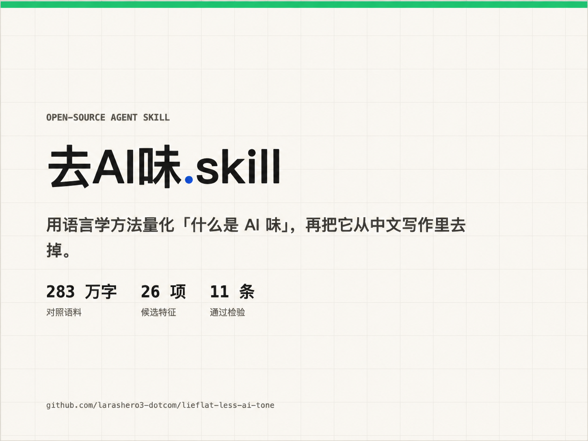

# Lieflat Less AI Tone

中文 | [English](README.en.md)

**官网与商业授权：** [lieflat.work · Lieflat Less AI Tone](https://lieflat.work/skills/less-ai-tone/)



**一个基于两轮实测语料（共 1,169 篇、约 520 万汉字、100+ 项指标、约 50 万次模型语义判断）的去 AI 味 skill：先交付有指标、研究参照、原文例句和改法的检测报告，用户回复后再改写和复测。**

这个 skill 用两轮对照研究筛选值得处理的写作特征，再对成稿做有依据的检测和最小改写。

---

## 1 研究问题

AI 在 Coding 能力提升的同时，写作的体感好像并没有同步变好，生成的文字依然读起来很奇怪。

比如不少主力模型智商极高，但写出来的长文我往往要读好几遍，很大的原因是它满篇都在用「不是技术问题，而是认知问题」的对举、密集的破折号和分号，还有完全理解不了的比喻。

为了处理这些问题，常见的做法是给模型列一张禁用词表，或者塞一段「去 AI 味 Prompt」。我也试过很长一段时间，但实操下来有两个明显痛点：

第一是禁用词表管不住真正的 AI 味。很多文章完全避开了「赋能」「闭环」「抓手」，标点也很克制，但读完三段依然一眼就能看出是 AI 写的。

第二是容易乱改、误伤正常表达。把十几条经验规则攒在一起喂给模型直接改稿，模型会非常激进地把文章里原本自然的设问句、「一、二、三」小标题一并删掉，甚至为了迎合「长短句参差」的指令，把顺畅的句子硬生生拆碎。

市面上流传的「AI 味清单」基本来自个案观察和个人语感，从未经过系统检验。我的思路是，从「读着像 AI」这个很难直接验证的主观体验里，找到若干个能客观反映模型写作特征的指标，先量化评测，再顺藤摸瓜地从工程和规则上把问题解决掉。

从源头看，把「去 AI 味」做成一套可靠的 Skill，核心只涉及三个问题：

第一，怎么把脚本数不出来的「AI 味」真正测准？这决定了能不能抓到藏在句子意思和上下文里的深层习惯。

第二，哪些语言特征是真正影响阅读体验的标准？这决定了改写规则往哪里发力。

第三，拿到这些指标后，如何管住模型的手？这决定了改写过程能否在清理套路的同时，不误伤作者原本的正常表达。

这些工作在构建思路上有两个相同的原则：

首先是有效，让每个指标能简洁直接地对应一个可定位的句法或篇章问题，通过指标高低，顺藤摸瓜地在规则上准确动刀。

其次是可靠，让评测与改写前后的变化尽量可以量化，避免凭感觉盲改。

## 2 两轮实验

### 2.1 第一轮实验：629 篇对照文本

语料生成方法：同一批话题，五个模型各写 60 篇，与 329 篇人类作者文章对照。

语料统计：

| 侧 | 篇 | 汉字 | 句 | 段 |
|---|---|---|---|---|
| 生成 | 300 | 1,179,105 | 37,642 | 14,549 |
| 人类 | 329 | 1,647,867 | 57,909 | 31,172 |

模型：claude-opus-4-6、deepseek-v4-pro、gemini-3.1-pro、gpt-5.6-sol、kimi-k3。人类侧分组独立统计，检验组间一致性。

判定标准： 倍率 R = 生成侧频率 ÷ 人类侧频率。R≥2.0 纳入；1.25–2.0 条件纳入（需人类侧组间一致且绝对量足）；0.8–1.25 排除；<0.8 人类更多，反向也不可作为删改依据。另有三项附加条件：组间一致性（极差≤5 倍）、算子可定位性（能指出改哪一句）、改写可操作性（"补虚词"无法验收，整项弃用）。

### 2.2 第二轮实验：270 对配对复测

第一轮实验的根本缺陷是语料不配对，第二轮收紧了这一点，选择将人类文章里的数字、事件提炼成任务卡发给 AI，让它在同样的事实约束下写同题文章。

三层测量标准：脚本层，语义层和人工层。脚本层用正则数标点个数、句长、小节数等完全可被量化计算的部分。语义层补充脚本层无法判断的语义理解部分，脚本先抽候选片段，模型对每条做封闭式判断（这是不是密集并列/结论宣告/结构复用），在这里使用 Jev 进行判断，总共判断50 万次。最后是人工测评层面。

一个特征在某一层测量中显著即可成立，不需要三层全通过。

| 层 | 工具 | 测什么 | 规模 |
|---|---|---|---|
| 脚本层 | Python 正则 + 统计 | 90 项可计算指标：标点密度、句长分布、词汇多样性（mtld/mattr）、欧化构式、小节几何、段落桥接、正式度波动、四字词、黑名单词 | 540 篇全量，配对 Wilcoxon + Cliff's δ，\|δ\|≥0.33 显著 |
| 语义层 | 结构化判断接口（Jev） | 9 项脚本测不了的语义指标：结论提示冒号、密集并列、序数词小标题、相邻句同构、段首零回指、句间段间衔接、"这意味着"复述、概括替代具体信息、拟人化喻体 + 活跃暗喻密度 | **约 50 万次判断**（第二轮 43.1 万 + 增补轮回指/同义重命名约 11 万）、1.92 万次请求、3.54 亿 token，全部落盘可复算 |
| 人工层 | 逐句标注 + 抽样复核 | 比喻贴切度、判据误判率 | AI 比喻失败模式归纳（硬套宏大意象、直译腔、混合比喻、三连标题） |

## 3 核心结果：最终指标汇总

按证据强度分四层。表中同时列出第一轮对照值和第二轮配对复测结果，并标明所属口径；配对复测的脚本层使用配对 Wilcoxon + Cliff's δ（|δ|≥0.33 为显著门槛），语义层约 50 万次模型判断。

δ 是什么：随机抽一篇 AI 文和一篇人类文对比，「AI 更多」的概率减去「AI 更少」的概率。正数=AI 比人类多，负数=AI 比人类少；绝对值越大差距越大，0.33 以上算显著，0.66 以上算差距很大。

### 3.1 第一层：通用显著 AI 味指标

由脚本层/语义层/人工层共同测出、GPT5.6 和 Opus4.6 同向显著的9条指标如下：

| 特征 | 脚本层证据（GPT δ / Opus δ） | 语义层证据 | 方向 |
|---|---|---|---|
| **欧化构式「不是A而是B」** | +0.88 / +0.72（最强纯写作信号） | 密集并列 1.45 倍 | 生成侧多。例：「用户购买的不是模型参数，而是一件每天要戴、需要充电、还会出现在社交场合的物品」「潘宇扬并不是从通用AI退回一个小功能，而是在尝试证明另一种生长顺序」 |
| **用词不敢重复（mtld/mattr）** | +0.91/+0.55、+0.75/+0.55 | — | 生成侧词汇更多样。例：同一段里「优化／增强／提升／提高」轮着用；「采用兼容体系……站点利用率就可能提升」——人类会反复用同一个词，AI 换着说 |
| **结构切得太碎** | 小节长度方差 −0.91/−0.75、小标题密度 +0.65/+0.83、每节句数 −0.63/−0.79、小节数 +0.51/+0.70（中位数 AI 7 vs 人类 1） | —（分节是纯结构特征，语义层不测） | 生成侧分节多而短且整齐。实测抽样：AI 文 1.3–1.7 个小标题/千字（3000–6000 字的文章切 5–9 节），人类整篇连写、按自然话题换段 |
| **句长/节奏太均匀** | 句长方差 −0.88/−0.40、逗号小句长方差 −0.87(GPT) | — | 生成侧落差小。第一轮抽样中 AI 文句长 CV 0.41–0.55、人类 0.67；配对复测的人类参考值为 0.54，两轮口径不可直接混用，也不能据此机械调整句长 |
| **前置定语长（欧化）** | +0.48 / +0.54 | — | 生成侧名词前修饰长。例：「它还不是一套能够在任何餐桌上完全自动运行的系统」「这种连续数据也解释了为什么团队没有把产品做成一次拍照识别的工具」——中心词前面挂了二十来字的修饰 |
| **结论提示冒号** | 冒号总密度人类反而多（−0.37/−0.31） | 「结论提示」AI 2.1 倍（「核心是：」「残酷的现实是：」） | 生成侧爱先摆结论。例：「这组数字传递出一个残酷的现实：不管你是街边个体户的夫妻店……三个月是第一道坎，半年是生死线」 |
| **衔接过度顺滑** | — | AI 明确承接 98.9% vs 人类 95.2%；段间跳转 AI 2.1% vs 人类 7.2% | 生成侧段段紧扣。例：连续多段以「这也解释了为什么……」「从这个角度看……」开头（实测 30 篇里"这也解释了"起段 10 次）；人类每 14 段就有一次直接跳到新话题，AI 每 50 段才一次 |
| **密集并列/枚举** | 顿号 +0.56(GPT)、分号 +0.80(GPT) | AI 7.845 vs 人类 5.398 每千字（1.45 倍） | 生成侧爱排比列举。例：「火锅、快餐、家庭聚餐和独自进食，不同光线、不同穿着、……」一句连排多个场景维度 |
| **比喻贴切度差** | —（正则只能数比喻标记词，标记词密度人类反而多 2.4 倍） | —（六个大模型两两共识仅 0–40%，最高分段 22 句里 9 句误报——测不出是模型能力缺口，不是信号不存在） | **人工层确证**。失败模式：硬套宏大意象（"窄门""三根支柱"）、直译腔（"钢夹"）、混合比喻（"坠崖＋松动地板"）、三连标题。贴切度只能人审；skill 默认保留原文比喻 |

**一次重要的二次否决**：初次语义测评发现 24.7% 的可比较段落从具体信息变得更概括，曾据此设立改写规则。改用对称口径复查后，向相反方向变化的比例为 26.0%，净差近零；精确数字密度在配对复测中也无差异。因此“概括替代”已从改写规则降为 X 级，不再据此删改。原文事实和限定词仍受信息守恒原则保护。

### 3.2 第二层：不同模型有不同的写作特征

特征本质是高度重复的表层习惯，即标点与句法的使用偏好，包括破折号用多少、句子多长、爱不爱分号等。这类指标，判定证据主要来自脚本验证。主要有以下特征指标：

| 特征 | GPT-5.6 | Claude Opus 4.6 | 含义 |
|---|---|---|---|
| 破折号 | −0.54（比人类还少） | **+0.95**（100% 文章使用） | 方向完全相反，改写必须先知道文本像谁。Opus 例：「在营收急剧收缩的压力下，公司迅速启动了大规模的营销开支削减——最先被砍掉的，正是搜索广告和效果投放」 |
| 每小句「的」字 | −0.75 | +0.62 | GPT「的」用得比人类少，Opus 比人类多，方向相反 |
| 引号 | ≈0 | −0.67 | Opus 写文章明显不爱用引号，比人类少得多 |
| 分号 / 顿号 | +0.80 / +0.56 | −0.11 / +0.14 | GPT 专属。例：「对于食材分明的欧美常见"白人餐"，准确率可以超过90%；到了中餐火锅，准确率约为70%至80%；遇到糊状食物，则需要用户通过语音或事后手动补充」——三档场景用两个分号串成一句，人类更常拆成三句 |
| 句子结构绕（单动词句少等） | 全显著 | 全不显著 | GPT 专属，含三个子特征，各配例：**① 单动词句少**（δ−0.72）——一个动词撑一句的短直句（「转折发生在疫情期间。」「Odyss试图把这一步交给机器。」）在 GPT 文中稀少，取而代之的是动词堆叠：「项链利用多模态视觉大模型，观察食物被送入口中的过程，再把零散的进食动作还原成一天的饮食记录」——一句四个动词连环。**② 静态句少**（δ−0.71）——直陈状态/判断的句子（「问题在于，开发者影响力不等于消费者入口。」）人类常用，GPT 偏爱把一切都写成动作过程。**③ 主谓距离短**（δ−0.62）——人类常在主语和谓语之间插一大段：「续航能否覆盖一天，设备是否舒适，记录是否准确，建议是否真的改变饮食，这些问题只有在持续使用中才会显现」——主语到谓语隔了 30 字，GPT 很少这样写 |
| 少提问 | −0.59 | −0.12 | GPT 写文章明显不爱提问，比人类少得多；Opus 跟人类差不多 |
| 长句少/中句多 | −0.68/+0.81 | +0.05/+0.04 | GPT 写长句比人类少、中句比人类多：句长集中在中档（25–45 字），几乎没有 6–12 字的短促句收尾，也极少 60 字以上的长流水句 |
| 焦点后置 | +0.05 | +0.47 | Opus 专属：新信息压在句尾，铺垫占前大半句。「定价权不在工厂手里，品牌归属也不在工厂手里，工厂只是全球供应链上那个沉默的、可以被随时替换的生产节点」「如果说一个行业每天有近一万间门店关门，听起来像是危言耸听，但这恰恰是中国餐饮业正在发生的事」——读者要等最后才知道这句想说什么 |
| **活跃暗喻密度** | 2.099 ≈ 人类 2.066 | **2.851**（合并口径 1.2 倍全部由 Opus 拉高） | Opus 专属的研究观察，不是通用删改依据。GPT 暗喻量与人类无异；两种模型的比喻贴切度都需要人审，skill 默认保留原文比喻 |

### 3.3 第三层：不够显著的指标

| 特征 | 证据 |
|---|---|
| 段首零回指评论 | AI 4.9% vs 人类 3.3%（约 1.5 倍） |
| 相邻句高度同构 | AI 8.71% vs 5.52%（1.6 倍，三连句 2.75 倍） |
| AI 堆精确数字 | δ −0.06，话题混杂假象，配对后消失 |
| 赋能/闭环/抓手等黑名单词 | δ +0.10，配对同事实后无差 |
| "首先/其次/总之"连接词 | δ +0.02，对当代模型彻底失效 |
| "这意味着"式空转复述 | 人类反而多（三项口径全反） |

## 4 工作流

```bash
# 第一步：脚本检测（只报告，不改写；--json 存档供第四步用）
python3 scripts/detect.py <文件或目录> --json > /tmp/before.json

# 第 1.5 步：语义层候选抽取 + 会话内模型按封闭判据判读
#   （同义重命名段 / 段间衔接接口 / 冒号句 / 三连同构组，
#     判据见 references/semantic-criteria.md，单篇约 40-80 条）
python3 scripts/detect.py <文件> --candidates --out /tmp/candidates.json

# 第二步：模型复核命中，报告本篇指标、研究显著性、例句、改法和排除项；等待用户回复

# 第三步：收到用户回复后，按其接受或调整的方案改写（规则见 SKILL.md）

# 第四步：复测 + 前后对比报告（默认 Markdown，--format html 出网页版）
python3 scripts/detect.py <改后文件> --json > /tmp/after.json
python3 scripts/report.py 原文 改后文 /tmp/before.json /tmp/after.json \
    --semantic /tmp/candidates_labeled.json --out 去AI味报告.md
```

完整示例：[Agent 记忆问题案例](examples/agent-memory-case/README.md)。其中有改前报告、改后全文、左右两列 HTML 对照页和复测结论。

检测分三层：**脚本层**（数得出符号的，detect.py）、**语义层**（要理解句意的四项，会话内模型按封闭判据逐条判）、**人审层**（比喻贴切度/暗喻/拟人喻体——模型间共识只有 0-40%，只列出不判）。

检测报告分级：

| 级 | 含义 | 处理 |
|---|---|---|
| A | 机械改：删提示语、换标点，零语义风险 | 模型复核误报并提出建议；用户回复后改 |
| B | 建议改：顿号罗列、长定语，需句式重组 | 模型逐条筛选并提出建议；用户回复后改 |
| C | 只报告：句长均匀、结构碎——整篇级问题 | 默认不改；用户主动要求时再处理 |
| H | 人审区：拟人喻体等贴切度问题，模型判不准 | 默认保留；用户主动要求时再列清单 |
| X | 已否决：实测不是 AI 味（配对复测反向） | 永不改，展示计数防误改 |
| F | 指纹：破折号/分号/引号等分模型特征 | 带方向解读；可安全改写的局部命中默认建议改，保留须给具体理由 |

### 防过度改写

模型改写 AI 味最常见的失败是改过头：为"像人写的"把句子改得忽长忽短、拆段落、删掉本来正常的表达。SKILL.md 定了六条改写原则：**最小改动**（一处命中只改必需部分）、**信息守恒**（改写后每个实词须能在原文指出出处）、**不制造参差**（句长离散度人机无差异，不为节奏改句长）、**结构不动**、有风格参考时以参考为准、改后三查加复测。

检测报告的结构区（句长 CV、节长 CV、同构/百段、小标题密度）会标明各参考值所属轮次与计算口径。配对复测的句长 CV 人类参考值为 0.54；第一轮抽样的 0.67 不与其混用，也不把任何指标强行推到目标值——机械参差化比不改更糟。

## 5 方法论教训

研究过程本身的缺陷，记录在 RESEARCH.md，共六次测量失误（宽正则误测、分母选择错误）和两次配对复测推翻。

## 6 复算

```bash
# 单篇/单目录检测报告
python3 scripts/detect.py <目录>

# 人类 vs 生成语料的规则命中率对比（需自备语料）
python3 scripts/compare-human-ai.py --human <目录...> --ai <目录...>

# 段落级：句子同构（段首零回指已于 2026-10-26 移除：弱信号，与已反转的指代不清同族）
python3 scripts/check-structure.py --human <目录...> --ai <目录...>

# 译文句式频率（生成侧）
python3 scripts/check-translationese.py <目录...>
```

语料因版权不入库，数字第三方无法直接核验；可复用的是方法、判定阈值和算子定义，全部在脚本内公开。换成自有语料即可重算全部指标。

## 7 局限

1. 语义层是单模型判断，抽样复核误判 15–30%，方向可信、精确百分点不可信
2. 人类语料组间差异大（破折号极差百倍），扩充语料可能改变部分结论
3. 模型迭代持续向人类文风收敛，所有频率数值是特定时点观测
4. 比喻贴切度、案例是否凑数、参差的质量，机器测不了，只能人审

---

**规则集** [SKILL.md](./SKILL.md) · **检测协议** [DETECT.md](./DETECT.md) · **完整实测记录** [RESEARCH.md](./RESEARCH.md)

## 8 安装与使用

让支持 Agent Skills 的 AI 安装仓库中的 `lieflat-less-ai-tone` skill；也可以在本机运行：

```bash
npx skills add larashero3-dotcom/lieflat-less-ai-tone
```

安装后给 AI 一篇成稿。它会先运行脚本并判读语义候选，交付有研究参照、原文例句和具体改法的检测报告。你回复「按建议改」或调整范围后，它才改写、复测并生成前后对比。完整演示见 [Agent 记忆问题案例](./examples/agent-memory-case/README.md)。

---

**数据与代码** [scripts/](./scripts/) · **English** [README.en.md](README.en.md)

**许可** [CC BY-NC 4.0](./LICENSE)（署名-非商业性使用 4.0；商业使用请[在 lieflat.work 选择并购买授权](https://lieflat.work/skills/less-ai-tone/#pricing)）
